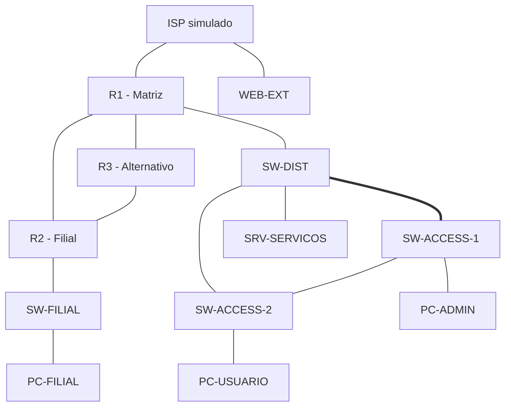

# CCNA Enterprise Lab - Matriz e filial
**Autor:** Matheus Dores | **Planejamento:** 13/10/2026
**Estado:** projeto documentado; imagens, configuração e testes ainda pendentes.

## Objetivo
Retomar a preparação para o CCNA com um cenário integrado: VLSM, VLANs, trunks, LACP, STP, roteamento, serviços, IPv6 e segurança. O diferencial será documentar o raciocínio e a validação, incluindo falhas controladas. Não representa uma simulação oficial da prova nem cobre sozinho todos os tópicos.

## Topologia

O enlace duplo entre DIST e ACCESS-1 será um Port-channel LACP. Os três switches da matriz formam um domínio STP; a filial é um domínio L2 separado. R1 fará router-on-a-stick na matriz e R2 na filial. O ISP e WEB-EXT são uma internet simulada, sem ligação à LAN doméstica nesta primeira etapa.

## Imagens e dependências
| Tipo | Quantidade | Arquivo ou componente | Uso |
|---|---:|---|---|
| Cisco IOSv | 4 nós | Exemplo reconhecido pelo registry: `vios-adventerprisek9-m.spa.159-3.m12.qcow2` | R1, R2, R3, ISP |
| Cisco IOSvL2 | 4 nós | Exemplo: `vios_l2-adventerprisek9-m.ssa.high_iron_20200929.qcow2` | DIST, ACCESS-1, ACCESS-2, FILIAL |
| VPCS | 3 nós | Executável `vpcs`, sem imagem QCOW2 | PCs de teste |
| Ubuntu Server | 2 nós | ISO oficial Ubuntu Server 22.04 LTS ou outra versão suportada escolhida | SRV-SERVICOS e WEB-EXT |
| Wireshark | Cliente Windows | Aplicativo, sem imagem de VM | Capturas de protocolos |
| Template IOSv | 1 arquivo | `cisco-iosv.gns3a` | Importação |
| Template IOSvL2 | 1 arquivo | `cisco-iosvl2.gns3a` | Importação |
| Disco auxiliar IOSv | Conforme assistente | `IOSv_startup_config.img` | Imagem auxiliar prevista no template, não é firmware |

Uma imagem de cada tipo é reutilizada por múltiplos nós com discos de escrita separados. Os nomes Cisco são exemplos do registry consultado, não versões obrigatórias nem confirmação de arquivos disponíveis ao autor. Não basta renomear uma imagem diferente para fazer o hash corresponder.

**Fontes:** [IOSv template](https://github.com/GNS3/gns3-registry/blob/master/appliances/cisco-iosv.gns3a), [IOSvL2 template](https://github.com/GNS3/gns3-registry/blob/master/appliances/cisco-iosvl2.gns3a), [Ubuntu Server](https://ubuntu.com/download/server), [Wireshark](https://www.wireshark.org/download.html).

**Aquisição Cisco:** utilizar acesso autorizado ao [Cisco Software Download](https://software.cisco.com/) e conferir os direitos de uso da imagem. A [documentação atual do CML](https://developer.cisco.com/docs/modeling-labs/vm-images-for-cml-labs/) informa que suas imagens são licenciadas para uso dentro do CML; uso externo exige licença adequada. Uma assinatura CML, por si só, não deve ser apresentada como autorização automática para GNS3. Se não houver direito de uso externo, executar este desenho em CML ou adaptar para Packet Tracer. Não publicar imagens/licenças no repositório.

FortiManager, FortiGate, ASAv, CSR1000v e controladora wireless não são necessários para a etapa principal. Wireless será estudado em cenário complementar; throughput medido em imagens virtuais não equivale ao desempenho físico.

## Recursos iniciais
Planejamento, sujeito à imagem selecionada:
- IOSv: começar pelo template (512 MB RAM, 1 vCPU por nó).
- IOSvL2: começar pelo template (768 MB RAM, 1 vCPU por nó).
- Ubuntu de serviços: 1 GB RAM/1 vCPU e 12 GB de disco por nó; aumentar se necessário.
- VPCS: consumo reduzido.
A soma nominal de RAM dos oito nós Cisco é cerca de 5 GB, mais 2 GB dos hosts, além do Ubuntu GNS3 e buffers. A VM GNS3 atual tem 6 vCPUs e 16 GB RAM; ligar progressivamente e monitorar CPU, memória e disco. A disponibilidade física do Proxmox com FortiManager ligado ainda precisa ser conferida.

## VLSM IPv4 proposto
| Segmento | VLAN | Rede/máscara | Gateway | Intervalo útil | Broadcast |
|---|---:|---|---|---|---|
| Usuários matriz | 20 | 10.85.0.0/25 - 255.255.255.128 | 10.85.0.1 | .1 a .126 | 10.85.0.127 |
| Administração matriz | 10 | 10.85.0.128/26 - 255.255.255.192 | 10.85.0.129 | .129 a .190 | 10.85.0.191 |
| Servidores matriz | 30 | 10.85.0.192/27 - 255.255.255.224 | 10.85.0.193 | .193 a .222 | 10.85.0.223 |
| Gerenciamento matriz | 99 | 10.85.0.224/28 - 255.255.255.240 | 10.85.0.225 | .225 a .238 | 10.85.0.239 |
| Usuários filial | 40 | 10.85.1.0/26 - 255.255.255.192 | 10.85.1.1 | .1 a .62 | 10.85.1.63 |
| Gerenciamento filial | 99 | 10.85.1.64/28 - 255.255.255.240 | 10.85.1.65 | .65 a .78 | 10.85.1.79 |

Hosts estáticos: PC-ADMIN 10.85.0.130/26; SRV-SERVICOS 10.85.0.194/27; DIST .226/28, ACCESS-1 .227/28, ACCESS-2 .228/28; SW-FILIAL 10.85.1.66/28. Gateways conforme tabela.
DHCP: usuários matriz 10.85.0.10-10.85.0.100; filial 10.85.1.10-10.85.1.50. DNS interno 10.85.0.194. VLANs 99 dos sites não têm continuidade L2.

| Enlace | Rede | Extremidade A | Extremidade B |
|---|---|---|---|
| R1-R2 | 10.85.255.0/30 | R1 10.85.255.1 | R2 10.85.255.2 |
| R1-R3 | 10.85.255.4/30 | R1 10.85.255.5 | R3 10.85.255.6 |
| R3-R2 | 10.85.255.8/30 | R3 10.85.255.9 | R2 10.85.255.10 |
| ISP-R1 | 198.51.100.0/30 | ISP 198.51.100.1 | R1 198.51.100.2 |
| ISP-WEB | 203.0.113.0/24 | ISP 203.0.113.1 | WEB-EXT 203.0.113.10 |

Loopbacks/router IDs: R1 10.85.254.1/32, R2 .2/32, R3 .3/32. Anunciar no OSPF. Blocos 198.51.100.0/24, 203.0.113.0/24 e IPv6 2001:db8::/32 são utilizados somente como documentação/simulação.

## Mapa de portas
Proposta para IOSv/IOSvL2; confirmar nomes na imagem antes de aplicar.
| Origem | Destino | Função |
|---|---|---|
| R1 Gi0/0 | DIST Gi0/0 | Trunk VLANs 10,20,30,99,999 |
| R1 Gi0/1 | R2 Gi0/1 | WAN principal |
| R1 Gi0/2 | R3 Gi0/0 | WAN alternativa |
| R1 Gi0/3 | ISP Gi0/0 | NAT outside |
| R3 Gi0/1 | R2 Gi0/2 | Alternativa filial |
| R2 Gi0/0 | FILIAL Gi0/0 | Trunk VLANs 40,99,999 |
| ISP Gi0/1 | WEB-EXT eth0 | Rede externa simulada |
| DIST Gi0/1 e Gi0/2 | ACCESS-1 Gi0/0 e Gi0/1 | LACP Port-channel 1 |
| DIST Gi0/3 | ACCESS-2 Gi0/0 | Trunk |
| ACCESS-1 Gi0/2 | ACCESS-2 Gi0/1 | Trunk redundante |
| ACCESS-1 Gi0/3 | PC-ADMIN | Access VLAN10 |
| ACCESS-2 Gi0/2 | PC-USUARIO | Access VLAN20 |
| DIST Gi1/0 | SRV-SERVICOS eth0 | Access VLAN30 |
| FILIAL Gi0/1 | PC-FILIAL | Access VLAN40 |

VLAN999 nativa consistente e sem hosts; portas não usadas desligadas. Configurar PortFast/BPDU Guard apenas nas portas de hosts. R1 Gi0/0 e R2 Gi0/0 físicos sem IPv4: gateways nas subinterfaces dot1q.

## Política e serviços
- OSPFv2 processo 1, somente área 0; WAN point-to-point e interfaces LAN passivas.
- Custos OSPF: principal R1-R2 = 10, cada trecho alternativo = 20, em ambos os sentidos. Registrar escolha e failover.
- Default IPv4 R1 via ISP 198.51.100.1; divulgar com default-information originate quando existir default. ISP não participa do OSPF corporativo.
- PAT no R1, outside Gi0/3 e inside nas subinterfaces LAN e nos dois enlaces corporativos que podem transportar tráfego da filial.
- Etapa DHCP: R1 como servidor para VLAN20 e VLAN40; relay no R2 VLAN40 para 10.85.255.1. Sem pool sobreposto aos IPs estáticos.
- SRV-SERVICOS: DNS de lab, NTP, Syslog e HTTP. WEB-EXT: HTTP para validar PAT. Inicialmente usar registros DNS locais e relógio/NTP de lab; não depender de internet real.
- ACL estendida na entrada da VLAN20: permitir DNS UDP/TCP53 e HTTP TCP80 ao SRV, negar outros destinos internos 10.85.0.0/16 e permitir demais destinos da simulação. Administração pode gerenciar os equipamentos.
- Restrição SSH nas VTY: permitir apenas 10.85.0.128/26. SSHv2, usuário local e senhas próprias não publicadas.
- Port Security nos hosts; DHCP Snooping/DAI somente após conferir suporte da imagem e planejar portas trusted. Hosts estáticos exigem bindings/ARP ACL adequados para DAI.
- FHRP será exercício conceitual ou extensão posterior, pois este desenho tem um gateway por site.

## IPv6 proposto
| Segmento | Prefixo | Gateway |
|---|---|---|
| VLAN10 | 2001:db8:85:10::/64 | ::1 |
| VLAN20 | 2001:db8:85:20::/64 | ::1 |
| VLAN30 | 2001:db8:85:30::/64 | ::1 |
| VLAN99 matriz | 2001:db8:85:99::/64 | ::1 |
| VLAN40 | 2001:db8:85:40::/64 | ::1 |
| VLAN99 filial | 2001:db8:85:199::/64 | ::1 |
| R1-R2 | 2001:db8:85:100::/64 | R1 ::1, R2 ::2 |
| R1-R3 | 2001:db8:85:101::/64 | R1 ::1, R3 ::2 |
| R3-R2 | 2001:db8:85:102::/64 | R3 ::1, R2 ::2 |

Habilitar ipv6 unicast-routing, verificar link-local/neighbor discovery. Configurar rotas estáticas entre os prefixos LAN pelo enlace principal, depois rotas flutuantes pelo alternativo com distância maior. IPv6 não utilizará NAT. OSPFv3 é extensão opcional; o foco de OSPF deste projeto é OSPFv2 em área única.

## Etapas de execução
1. Importar templates e imagens autorizadas; registrar versão e recursos; criar projeto.
2. Montar enlaces conforme mapa; conferir CDP/LLDP e estado das interfaces.
3. Fazer VLSM manualmente e validar gateway/máscara/broadcast.
4. Criar VLANs e trunks; validar router-on-a-stick.
5. Formar LACP; definir DIST root primary e ACCESS-1 root secondary em Rapid PVST+; registrar a porta alternativa do STP.
6. Configurar OSPF, default e PAT; testar matriz-filial e WEB-EXT.
7. Implementar DHCP/relay e serviços; conferir leases e logs.
8. Aplicar ACL e proteção de acesso; executar testes positivos e negativos.
9. Configurar IPv6 e rotas estáticas; validar failover separado do IPv4.
10. Introduzir uma falha por vez, restaurar e registrar evidências.

## Testes de aceitação - todos pendentes
| ID | Ação | Resultado esperado | Evidência |
|---|---|---|---|
| T01 | PC da VLAN20 solicita DHCP | Endereço do pool, gateway .1, DNS .194 | Lease/pcshow e DHCP |
| T02 | PC filial solicita DHCP | Pool filial através de relay | Lease e capture DORA |
| T03 | Conferir LACP | Ambos os membros agregados | show etherchannel summary |
| T04 | Remover um membro LACP | Port-channel continua operacional | Ping + estado dos membros |
| T05 | Derrubar DIST-ACCESS-2 | Tráfego migra pelo enlace entre accesses | STP + ping |
| T06 | Conferir OSPF | Vizinhos FULL e rotas LAN | show ip ospf neighbor / route |
| T07 | Derrubar R1-R2 | Filial continua acessível via R3 | Traceroute antes/depois |
| T08 | HTTP para WEB-EXT | Tradução PAT observável | curl/HTTP + show ip nat translations |
| T09 | VLAN20 HTTP/DNS para SRV | Permitido | curl/nslookup e contadores ACL |
| T10 | VLAN20 SSH para gerenciamento | Negado | Teste TCP/SSH e ACL |
| T11 | PC-ADMIN SSH | Permitido com credenciais corretas | Sessão SSH |
| T12 | IPv6 matriz-filial | Comunicação e rota correta | Ping/route IPv6 |
| T13 | Falha IPv6 principal | Uso da rota flutuante | Traceroute IPv6 |
| T14 | Alteração de interface | Evento no Syslog | Registro com timestamp |

Não estimar tempo de convergência antes de medir. Imagens virtuais não servem para comparar capacidade de encaminhamento com hardware físico.

## Falhas controladas
| Falha | Diagnóstico sugerido |
|---|---|
| VLAN20 ausente no trunk | show interfaces trunk; show vlan brief |
| LACP com membro em configuração diferente | show etherchannel summary; show interfaces switchport |
| Área OSPF divergente | show ip ospf interface; show ip ospf neighbor |
| Gateway DHCP incorreto | show ip dhcp pool/binding; configuração do cliente |
| ACL bloqueando DNS | show access-lists; captura DNS |
| NAT inside ausente na WAN filial | show ip nat statistics/translations |
| Rota IPv6 com next hop errado | show ipv6 route; ping por enlace |

Guardar checkpoints antes das falhas; salvar running-config após cada etapa validada.

## Evidências e entregas futuras
- Screenshot da topologia com nomes e endereços.
- Configs sanitizadas por equipamento, sem senhas/chaves.
- Saídas show e capturas essenciais, com esperado/observado.
- Projeto portátil GNS3 sem imagens proprietárias.
- Texto para LinkedIn após execução, citando somente testes realmente concluídos.

## Cobertura e fontes
A referência consultada foi o CCNA 200-301 v1.1. Revisar o blueprint oficial próximo da prova. Wireless, QoS, automação/JSON/APIs, arquiteturas, AI/ML e outros tópicos conceituais precisam de exercícios complementares; a lista não garante cobertura integral nem aprovação.
- [Cisco CCNA](https://www.cisco.com/site/us/en/learn/training-certifications/exams/ccna.html)
- [GNS3: importação de appliance](https://docs.gns3.com/docs/using-gns3/beginners/import-gns3-appliance)
- [Cisco: imagens e direitos de uso CML](https://developer.cisco.com/docs/modeling-labs/vm-images-for-cml-labs/)
